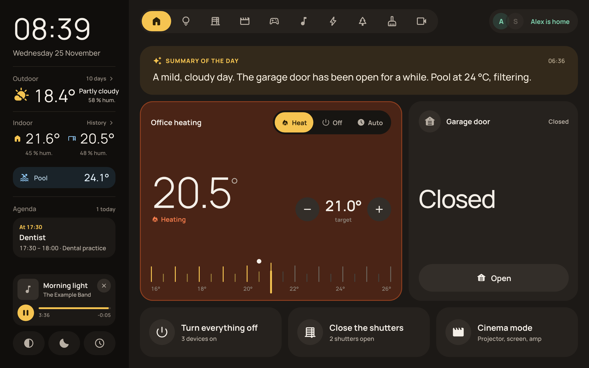
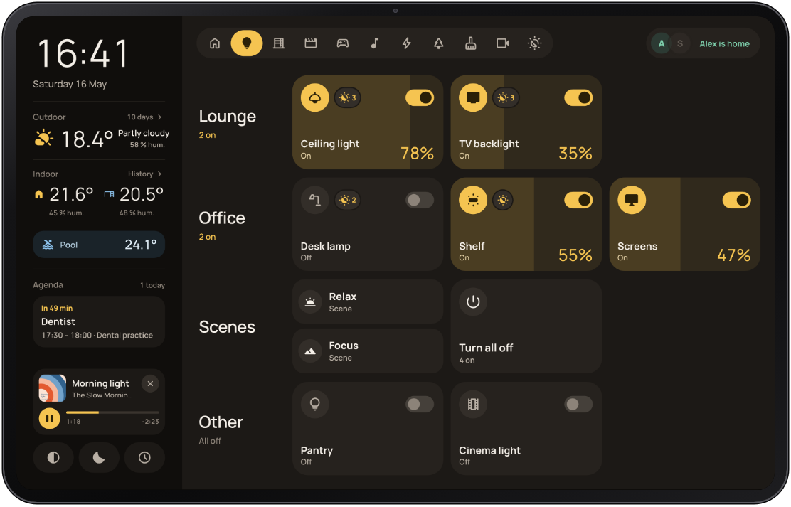
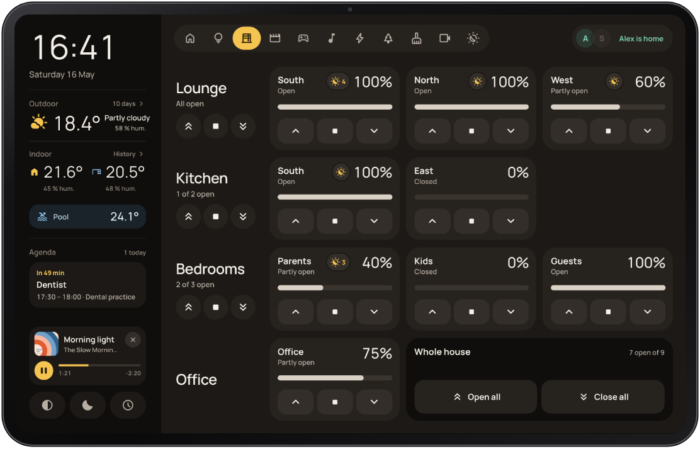
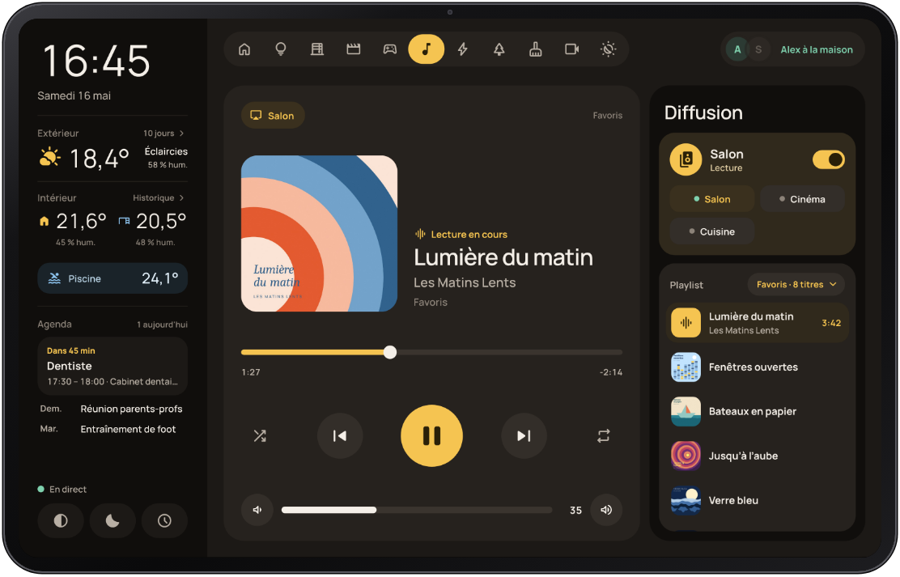
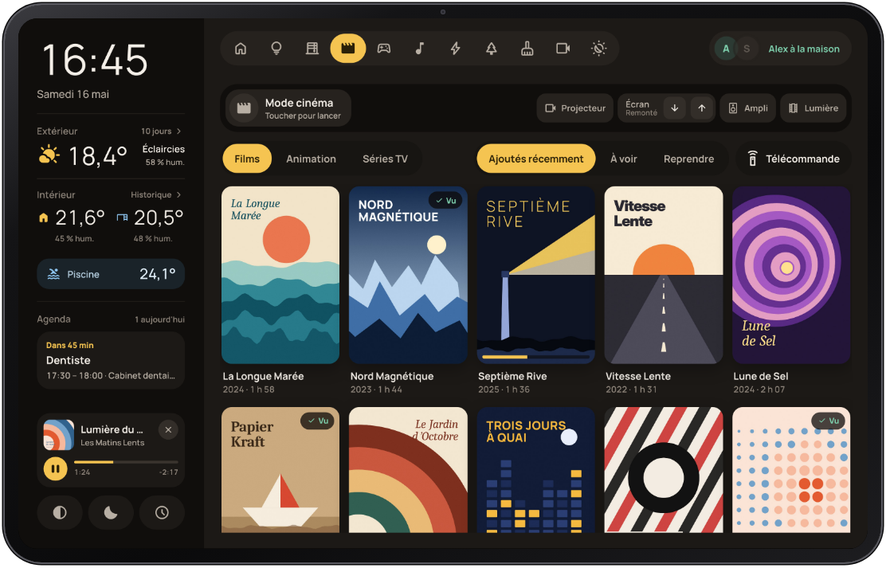
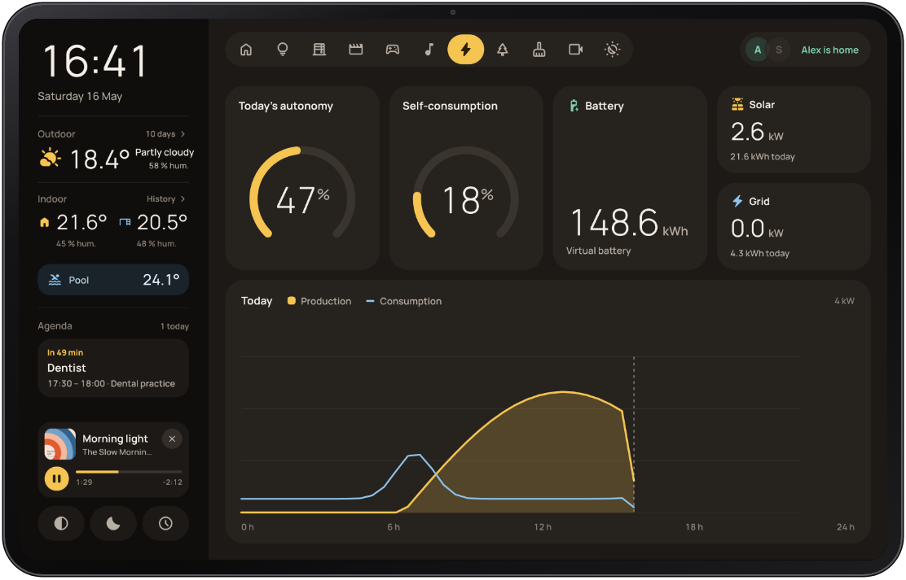
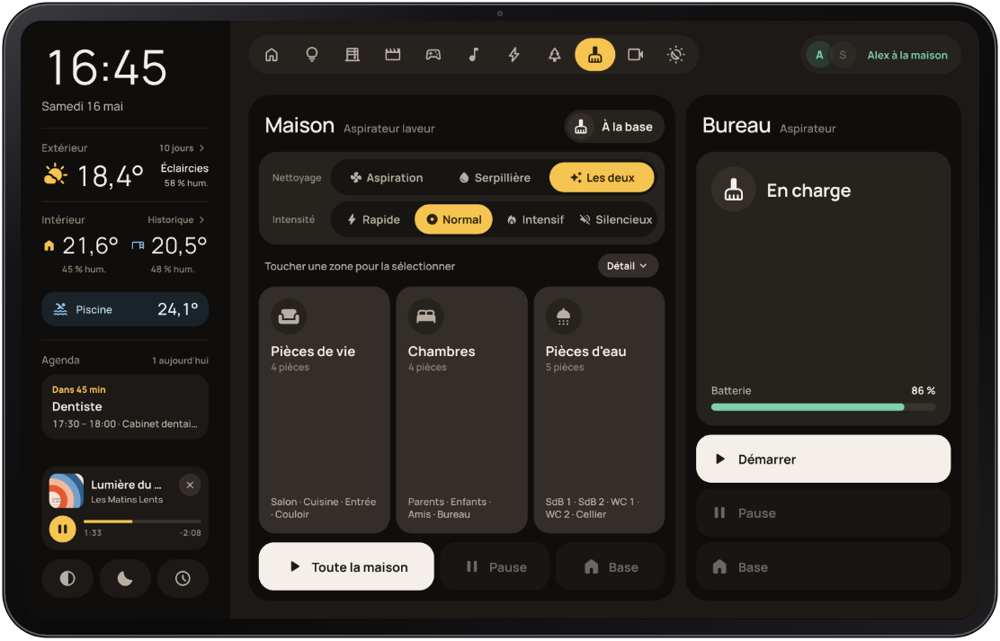
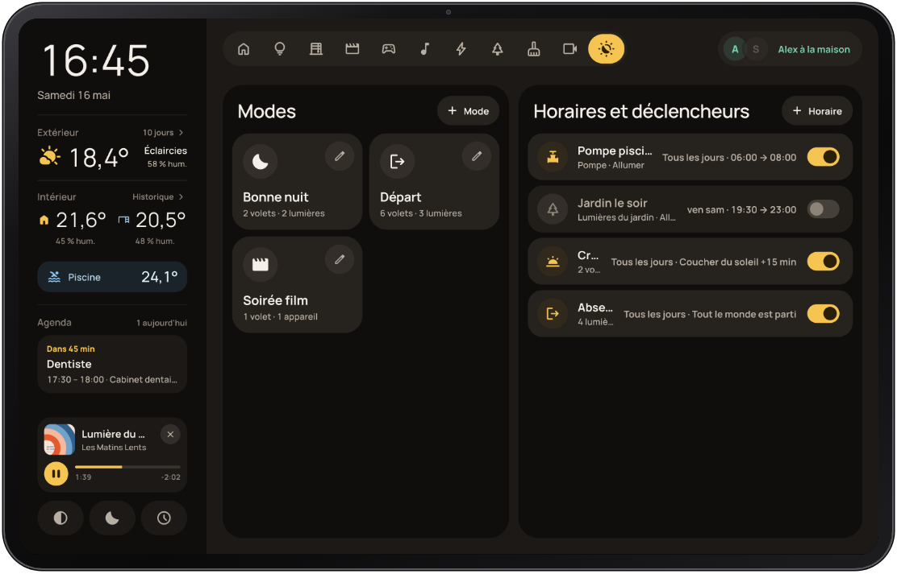
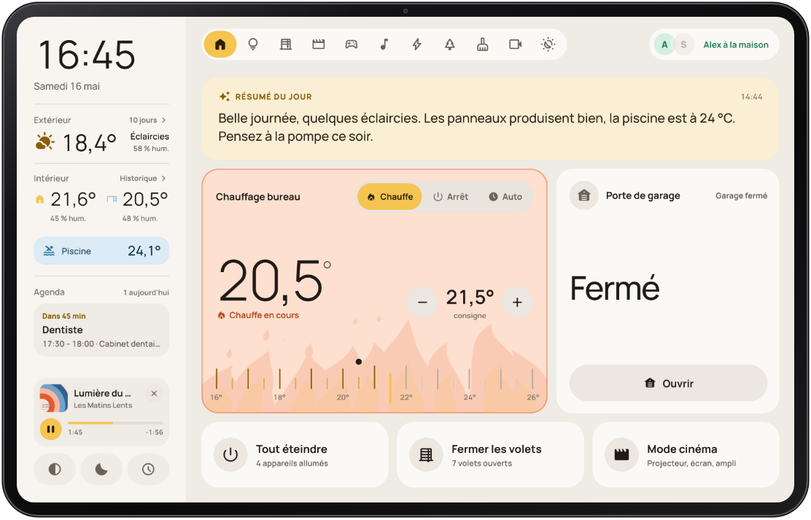

# Paddock

**Une interface de tablette murale pour Home Assistant** — lumières, volets, chauffage, caméras, musique, cinéma,
énergie, horaires et modes — qui tourne aussi en application de bureau sur Mac, Windows et Linux.

[Read in English](README.md)



| | |
|---|---|
|  |  |
|  |  |
|  |  |
|  |  |

<sub>Une maison fictive. Les affiches de films, les pochettes, les titres et les artistes sont inventés pour la démonstration.</sub>

- **Votre maison reste chez vous.** L'application ne contient rien sur votre maison. Tout ce qui vous est propre
  (entités, pièces, clés) tient dans un seul fichier, `paddock.yaml`, rangé dans votre Home Assistant et donné
  uniquement aux appareils connectés.
- **Seulement ce que vous avez.** Un écran que vous ne configurez pas (jeux, musique, énergie, caméras…) n'est pas affiché.
- **Des horaires et des modes, créés sur le mur.** « Départ », « Bonne nuit », la pompe de la piscine de 6 h à 8 h,
  les volets au coucher du soleil : créés et modifiés dans l'interface, exécutés par Home Assistant.
- **En français et en anglais.**
- **Le fichier de design est ouvert aussi.** Des variables pour les couleurs, les espaces, les rayons et le mouvement,
  117 composants et 66 écrans : [Paddock sur Figma](https://www.figma.com/design/8pflUMr4pHXgcoCuD2mCNK/Paddock) (consultation et duplication).

## Installer en quatre étapes

Il faut un Home Assistant qui fonctionne, ainsi que [Node 22+](https://nodejs.org) et [pnpm](https://pnpm.io) sur votre ordinateur.

```bash
git clone https://github.com/paduction/paddock && cd paddock
pnpm install
cp tools/deploy.example.env tools/deploy.local.env   # puis remplissez-le (adresse de Home Assistant, jeton, SSH)

pnpm discover --draft   # 1. lit votre Home Assistant et écrit un premier paddock.yaml
                        # 2. modifiez paddock.yaml : gardez ce que vous voulez au mur
pnpm config:check       # 3. le vérifie (réglages, et existence de chaque entité)
pnpm run deploy         # 4. construit et copie tout dans Home Assistant
```

Ensuite, dans Home Assistant : redémarrez une fois, ajoutez l'intégration **Paddock** (Paramètres → Appareils et services),
puis ouvrez `http://<votre-home-assistant>:8123/local/paddock.html` sur la tablette.

Le pas-à-pas complet, y compris une installation sans SSH, est dans **[docs/fr/install.md](docs/fr/install.md)**.

### Avec un assistant IA

Le dépôt est écrit pour être piloté par un assistant de programmation. Avec [Claude Code](https://claude.com/claude-code) :

```
/paddock-setup
```

Il pose quelques questions, lance les commandes ci-dessus à votre place, écrit `paddock.yaml` à partir de vos
vraies entités et le vérifie. Les autres assistants lisent [AGENTS.md](AGENTS.md), qui explique le dépôt et la même procédure.

## Documentation

| | Français | English |
|---|---|---|
| Installer | [install.md](docs/fr/install.md) | [install.md](docs/en/install.md) |
| Tous les réglages de `paddock.yaml` | [configuration.md](docs/fr/configuration.md) | [configuration.md](docs/en/configuration.md) |
| Ce dont chaque écran a besoin | [modules.md](docs/fr/modules.md) | [modules.md](docs/en/modules.md) |
| Horaires et modes | [automations.md](docs/fr/automations.md) | [automations.md](docs/en/automations.md) |
| Régler la tablette | [tablet.md](docs/fr/tablet.md) | [tablet.md](docs/en/tablet.md) |
| Comptes, sécurité, accès de l'extérieur | [security.md](docs/fr/security.md) | [security.md](docs/en/security.md) |

## Application de bureau (Mac, Windows, Linux)

La même interface dans une fenêtre de votre ordinateur : `apps/desktop` est une petite coque [Tauri](https://tauri.app) (Rust)
autour de l'application de la tablette. Au premier lancement, elle demande l'adresse de Home Assistant et un jeton
longue durée, puis lit le même `paddock.yaml` que la tablette.

```bash
pnpm desktop:dev     # la fenêtre, avec rechargement à chaud
pnpm desktop:build   # installeur dans apps/desktop/src-tauri/target/release/bundle
```

Il faut [Rust](https://rustup.rs) et, sous Linux, les bibliothèques WebKitGTK
(`libwebkit2gtk-4.1-dev libgtk-3-dev librsvg2-dev libayatana-appindicator3-dev`).
Il n'y a pas d'installeur à télécharger : vous construisez l'application sur votre ordinateur, pour le système
sur lequel vous êtes, à partir de votre copie du code. Elle est construite et utilisée tous les jours sous macOS, et ses
paquets Linux (deb, rpm, AppImage) se construisent. Windows n'a pas encore été essayé : si vous la construisez là,
un ticket racontant comment cela s'est passé est le bienvenu.

Ce qui diffère de la tablette : les liens s'ouvrent dans votre navigateur, F11 passe en plein écran,
la fenêtre retient sa taille, et il n'y a pas d'écran de veille.

## Travailler sur le code

Le code, ses commentaires et le guide des contributeurs sont en anglais : voir la section
[Working on the code](README.md#working-on-the-code) du README anglais et [AGENTS.md](AGENTS.md).
Pour proposer un changement : [CONTRIBUTING.md](CONTRIBUTING.md). Pour signaler un problème de sécurité : [SECURITY.md](SECURITY.md).

## Crédits

- Icônes : [Material Symbols Rounded](https://fonts.google.com/icons) — Apache 2.0
- Police : [Manrope](https://fonts.google.com/specimen/Manrope) — SIL Open Font License
- Coque de bureau : [Tauri](https://tauri.app) — MIT / Apache 2.0
- Connexion à Home Assistant : [home-assistant-js-websocket](https://github.com/home-assistant/home-assistant-js-websocket) — Apache 2.0
- Fiches de jeux : [RAWG](https://rawg.io) (votre propre clé gratuite), Wikipédia et Wikidata

Paddock est un projet indépendant, sans lien avec Home Assistant, Plex, Sony ou Apple. Licence MIT.
