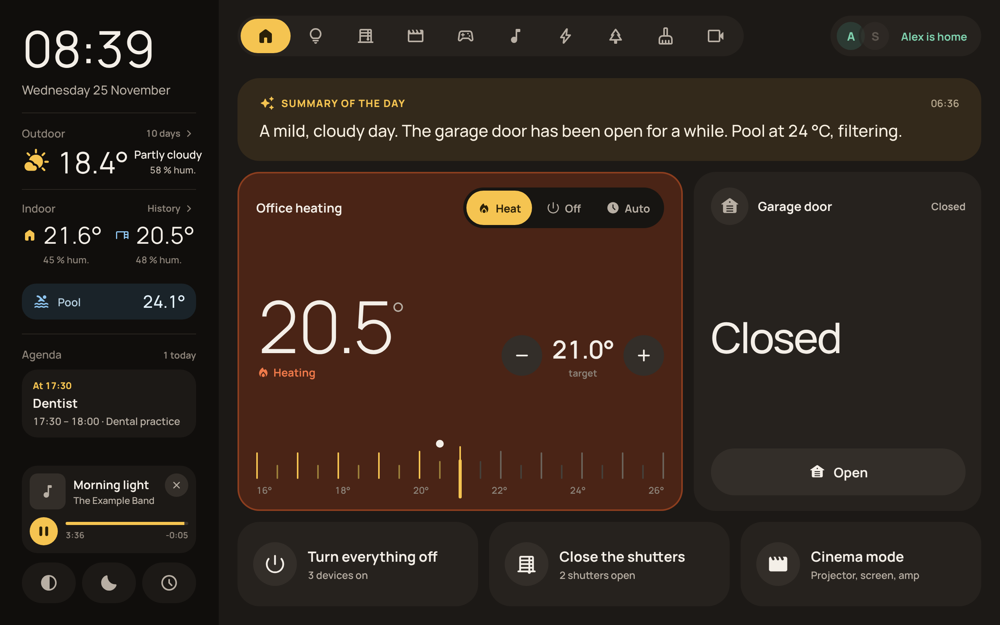
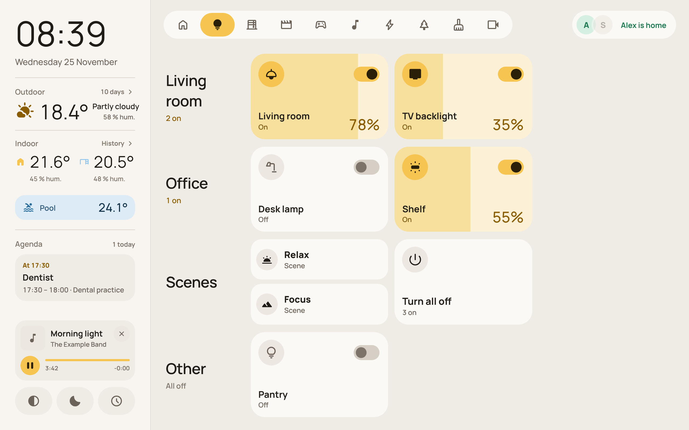
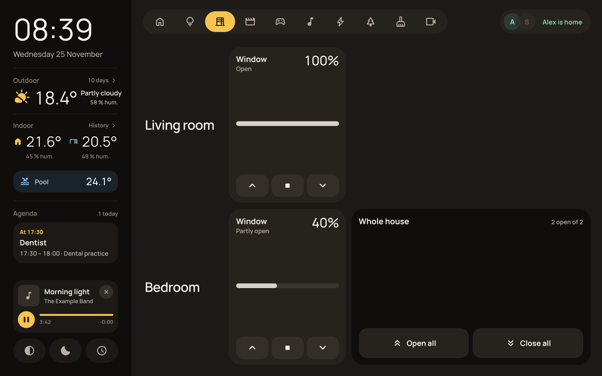

# Paddock

**A wall-tablet interface for Home Assistant** — lights, shutters, heating, cameras, music, cinema, energy —
that also runs as a desktop app on Mac, Windows and Linux.

[Lire en français](README.fr.md)



| | |
|---|---|
|  |  |

- **Your home stays yours.** The app contains nothing about your house. Everything specific (entities, rooms, keys)
  lives in one file, `paddock.yaml`, inside your Home Assistant, and is only given to signed-in devices.
- **Only what you have.** A screen you do not configure (games, music, energy, cameras…) is simply not shown.
- **English and French.**

## Install in four steps

You need a working Home Assistant, plus [Node 22+](https://nodejs.org) and [pnpm](https://pnpm.io) on your computer.

```bash
git clone https://github.com/paduction/paddock && cd paddock
pnpm install
cp tools/deploy.example.env tools/deploy.local.env   # then fill it in (Home Assistant address, token, SSH)

pnpm discover --draft   # 1. reads your Home Assistant and writes a first paddock.yaml
                        # 2. edit paddock.yaml: keep what you want on the wall
pnpm config:check       # 3. checks it (settings, and that every entity exists)
pnpm run deploy         # 4. builds and copies everything to Home Assistant
```

Then, in Home Assistant: restart once, add the **Paddock** integration (Settings → Devices & services),
and open `http://<your-home-assistant>:8123/local/paddock.html` on the tablet.

The full walk-through, including an install without SSH, is in **[docs/en/install.md](docs/en/install.md)**.

### With an AI assistant

The repository is written to be driven by a coding assistant. With [Claude Code](https://claude.com/claude-code):

```
/paddock-setup
```

It asks a few questions, runs the commands above for you, writes `paddock.yaml` from your real entities and
checks it. Other assistants read [AGENTS.md](AGENTS.md), which explains the repository and the same procedure.

## Documentation

| | English | Français |
|---|---|---|
| Install | [install.md](docs/en/install.md) | [install.md](docs/fr/install.md) |
| Every setting of `paddock.yaml` | [configuration.md](docs/en/configuration.md) | [configuration.md](docs/fr/configuration.md) |
| What each screen needs | [modules.md](docs/en/modules.md) | [modules.md](docs/fr/modules.md) |
| Setting up the tablet | [tablet.md](docs/en/tablet.md) | [tablet.md](docs/fr/tablet.md) |
| Accounts, security, access from outside | [security.md](docs/en/security.md) | [security.md](docs/fr/security.md) |

## Desktop app (Mac, Windows, Linux)

The same interface in a window on your computer: `apps/desktop` is a small [Tauri](https://tauri.app) shell (Rust)
around the tablet build. At first launch it asks for your Home Assistant address and a long-lived token,
then reads the same `paddock.yaml` as the tablet.

```bash
pnpm desktop:dev     # the window, with live reload
pnpm desktop:build   # installer in apps/desktop/src-tauri/target/release/bundle
```

You need [Rust](https://rustup.rs) and, on Linux, the WebKitGTK libraries
(`libwebkit2gtk-4.1-dev libgtk-3-dev librsvg2-dev libayatana-appindicator3-dev`).
An installer is built for the system you build on; `.github/workflows/desktop.yml` builds all three on GitHub.

What differs from the tablet: links open in your browser, F11 switches to full screen,
the window remembers its size, and there is no screensaver.

## Working on the code

```bash
pnpm dev          # http://localhost:5173 — asks for your Home Assistant address and a token
pnpm test         # rules of the home (Vitest)
pnpm typecheck
pnpm build        # apps/tablet/dist
```

```
packages/
  core/     no React — Home Assistant connection (ha/), rules of the home (domain/), shape of paddock.yaml (config/)
  ui/       no Home Assistant — touch components, design tokens, fonts. Props in, events out.
apps/
  tablet/   the app: stores (controllers), widgets (store + ui), pages, i18n (fr / en)
  desktop/  the same app in a desktop window (Tauri shell, no interface code of its own)
custom_components/paddock/   Home Assistant integration: serves paddock.yaml to signed-in devices
server/plex-info/            optional: read-only view of a Plex library for the Films screen
tools/                       discover, config:check, deploy
```

The rule that keeps it readable: a component in `ui` never knows Home Assistant exists,
and a rule in `core/domain` never knows React exists.

| Layer | Example | Depends on |
|---|---|---|
| Domain rule | `core/src/domain/lights.ts` — what is a lit light, which service to call | nothing |
| Controller | `tablet/src/stores/lights.store.ts` — state + allowed actions | core |
| Component | `ui/src/components/LightTile` — drawing and gestures | nothing |
| Widget | `tablet/src/widgets/LightWidget.tsx` — connects one light to one tile | all of the above |

More in [AGENTS.md](AGENTS.md), which is as useful to people as to assistants.

## Credits

- Icons: [Material Symbols Rounded](https://fonts.google.com/icons) — Apache 2.0
- Typeface: [Manrope](https://fonts.google.com/specimen/Manrope) — SIL Open Font License
- Desktop shell: [Tauri](https://tauri.app) — MIT / Apache 2.0
- Home Assistant connection: [home-assistant-js-websocket](https://github.com/home-assistant/home-assistant-js-websocket) — Apache 2.0
- Game details: [RAWG](https://rawg.io) (your own free key), Wikipedia and Wikidata

Paddock is an independent project, not affiliated with Home Assistant, Plex, Sony or Apple. MIT licence.
